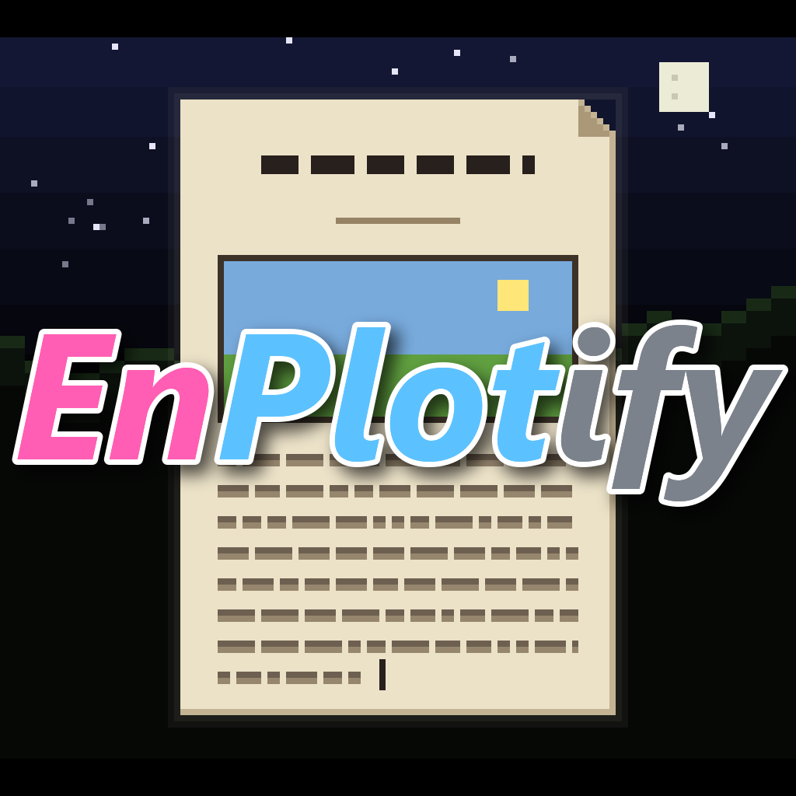

# 沉浸式剧情 · EnPlotify

> 本分支 / This branch: **26.1.2NeoForge**

[中文](#中文) · [English](#english)

> Author / 作者：**Arqiu-owo** · Code: `LGPL-3.0-only` · Assets: `CC-BY-NC-SA-4.0` — see [LICENSE.md](LICENSE.md)



---

## 中文

沉浸式剧情前置库：黑屏逐字的剧情模式，以及可以自己写字、配图的海报、报纸、文档、黑板和白板。其它模组只需写好文本，就能用上这些。

### 给玩家的

单独安装时，下面这些东西在普通生存里就能做、能用：

- **海报、报纸、文档、黑板、白板**：在编辑界面里写字（Minecraft 自己的字体，粗体、斜体、上下标）、插图片、写 LaTeX 公式；海报还能放 GIF 动图和视频。报纸、文档能一张张叠在桌上。
- **打印机**：复印文档、报纸、海报；支持漏斗和红石。
- **终端**：一台小电脑，可以管理文件、连打印机打印、连墙上的显示器，还带一个能上网的浏览器（由 FerricOxide 提供，已内嵌）。
- **显示器**、**望漠白板**（能写字的显示器）、**幽灵物品展示框**（框是隐形的）。

### 给模组作者的

- **剧情模式**：在资源里放每种语言的文本，调用 `EnPlotify.play(...)`，玩家就会在黑屏上看到一字一字打出来的剧情。多人时会一起看、排队、自动翻页；结束时发出事件。
- **常态剧情**：不黑屏，一句句台词显示在动作栏上方（`StoryLines`）。
- **任务进度**：定义剧情线和阶段（`StoryQuests`），玩家按 J 打开流程页，完成阶段时有横幅和音效。只有别的模组用到它时才有 J 键。
- **现成的纸张和书写板**：用 JSON 写好内容，注册成你自己模组的物品（`EnPlotifyContent`）。
- **终端主题**：自定义开机 LOGO 和桌面壁纸（`TerminalTheme`）。

详细用法见 [使用说明.md](使用说明.md)（中文）。

客户端和服务端都要安装。

### 支持的版本

| 分支 | Minecraft | 加载器 |
|---|---|---|
| [`26.1.2NeoForge`](../../tree/26.1.2NeoForge) | 26.1.2 | NeoForge 26.1.2.112+ |

每个版本是仓库里的一个**分支**（`26.1.2NeoForge` 是默认分支），分支根目录就是 Gradle 工程。

### 自己编译

需要 **JDK 25** 和 **Gradle 9.7+**（仓库里没有附带 Gradle Wrapper）。切换到想要的版本分支，在根目录运行：

```
gradle build
```

jar 会生成在 `build/libs/` 里。编译要用的两个别人的模组 jar 已经放在 `compile-libs/` 里：FerricOxide（LGPL-3.0，会打包进本模组）和 Jade（CC BY-NC-SA 4.0，只用来编译，不打包）。

---

## English

An immersive story library: a full-screen, typed-out story mode, plus posters, newspapers, documents, blackboards and whiteboards players can write on and illustrate. Other mods only supply the text to use them.

### For players

On its own, everything below can be crafted and used in normal survival:

- **Posters, newspapers, documents, blackboards, whiteboards**: write text in an editor (Minecraft's own font, bold, italic, super/subscript), add pictures and LaTeX formulas; posters can also show GIFs and videos. Newspapers and documents can be stacked on a table.
- **Printer**: copies documents, newspapers and posters; works with hoppers and redstone.
- **Terminal**: a small computer that keeps files, prints to printers, drives monitors on the wall, and has a real web browser (provided by FerricOxide, bundled).
- **Monitor**, **SAWMO Whiteboard** (a monitor you can write on), and the **Ghost Item Frame** (the frame is invisible).

### For mod authors

- **Story mode**: put the text for each language in your assets and call `EnPlotify.play(...)`; the player sees it typed out on a black screen. In multiplayer players watch together, stories queue and pages turn by themselves; events fire when a story ends.
- **Ambient lines**: no black screen, lines of dialogue shown above the action bar (`StoryLines`).
- **Quest map**: define story lines and stages (`StoryQuests`); players open the map with J and get a banner and a sound when a stage is done. The J key only exists when another mod uses it.
- **Ready-made papers and boards**: write their content in JSON and register them as your own mod's items (`EnPlotifyContent`).
- **Terminal themes**: your own start-up logo and desktop wallpaper (`TerminalTheme`).

Details are in [使用说明.md](使用说明.md) (Chinese).

Needed on both the client and the server.

### Supported versions

| Branch | Minecraft | Loader |
|---|---|---|
| [`26.1.2NeoForge`](../../tree/26.1.2NeoForge) | 26.1.2 | NeoForge 26.1.2.112+ |

Each version lives on its own **branch** (`26.1.2NeoForge` is the default branch); the branch root is the Gradle project.

### Building

Requires **JDK 25** and **Gradle 9.7+** (no Gradle Wrapper is included). Check out the branch for the version you want and run, in the repository root:

```
gradle build
```

The jar is written to `build/libs/`. The two jars of other mods needed to compile are already in `compile-libs/`: FerricOxide (LGPL-3.0, bundled into this mod) and Jade (CC BY-NC-SA 4.0, compile only, not bundled).

---

## 贡献者 / Contributors

- **Arqiu-owo** — 设计、美术、文案、调试 / Design, art, writing and testing
- **Claude**（Anthropic）— 程序、项目管理 / Programming and project management

## License / 许可证

- Code / 代码：[GNU LGPL v3.0](COPYING.LESSER)（with [GPL v3.0](COPYING)）
- Assets (images) / 素材（图片）：[CC BY-NC-SA 4.0](https://creativecommons.org/licenses/by-nc-sa/4.0/)

Details / 详情：[LICENSE.md](LICENSE.md)
